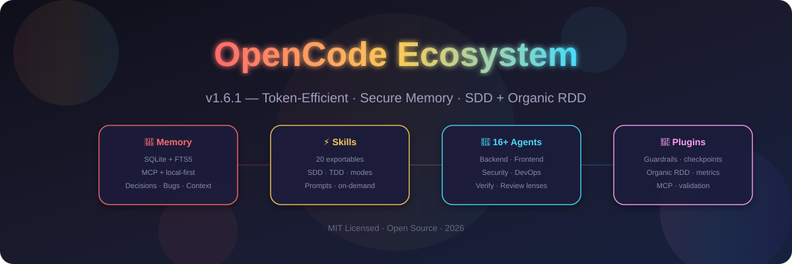
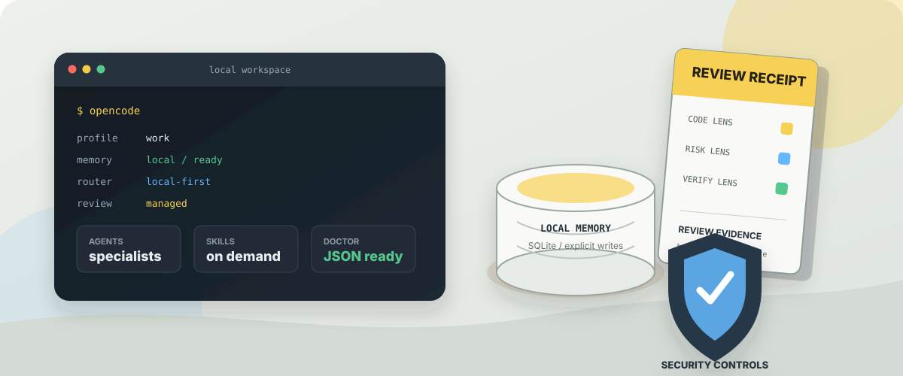

<p align="center">
  
</p>

<p align="center">
  <a href="https://github.com/Rukawua26/opencode-ecosystem/actions/workflows/test.yml"></a>
  <a href="https://www.npmjs.com/package/@rukawua26/opencode-memory-adapter"></a>
  <a href="https://www.npmjs.com/package/@rukawua26/opencode-skills"></a>
  
  
</p>

<h3 align="center">Tu entorno de agentes, instalado como software serio.</h3>

<p align="center">
  Configuracion reproducible para OpenCode con memoria local, skills bajo demanda,<br />
  routing de modelos y revision verificable. Linux, macOS y Windows.
</p>

<p align="center">
  <a href="#quick-start"><b>Instalar</b></a> ·
  <a href="#componentes"><b>Explorar componentes</b></a> ·
  <a href="#seguridad-y-persistencia"><b>Revisar seguridad</b></a> ·
  <a href="docs/README.md"><b>Leer documentacion</b></a>
</p>

<br />

<p align="center">
  
</p>

| Lo que obtienes | Para que sirve |
|---|---|
| **Memoria local y explicita** | Conserva decisiones y contexto en SQLite sin convertir la memoria automatica en autoridad. |
| **Agentes y skills bajo demanda** | Carga especialistas para codigo, seguridad, producto, SDD, TDD y documentacion cuando hacen falta. |
| **Routing local-first** | Usa Ollama para tareas acotadas y reserva el modelo cloud para riesgo o contexto alto. |
| **Cambios revisables** | Preview read-only, backups, doctor JSON, tests y receipts ligados al candidato exacto. |

## Quick Start

Requiere **Node.js 22+**, npm y Git.

### Linux / macOS

```bash
EXPECTED_COMMIT="36f41541536747c74d467856ca7cfede8f28c028"
git clone --branch v1.9.0 --depth 1 https://github.com/Rukawua26/opencode-ecosystem.git
cd opencode-ecosystem
test "$(git rev-parse HEAD)" = "$EXPECTED_COMMIT" || { echo "Commit inesperado" >&2; exit 1; }
bash install.sh
```

### Windows

```powershell
$expectedCommit = "36f41541536747c74d467856ca7cfede8f28c028"
git clone --branch v1.9.0 --depth 1 https://github.com/Rukawua26/opencode-ecosystem.git
Set-Location opencode-ecosystem
if ((git rev-parse HEAD) -ne $expectedCommit) { throw "Commit inesperado" }
.\install.ps1
```

Los instaladores descargan `v1.9.0` por defecto. Una reinstalacion normal conserva los archivos existentes. `main` incorpora un modo de sincronizacion que se publicara en la siguiente release; para probarlo sin sustituir `opencode.jsonc` ni archivos custom:

```bash
SYNC_COMMIT="5b42e7f7be280911982e80be5c3d8476a97fd134"
git init opencode-ecosystem
cd opencode-ecosystem
git remote add origin https://github.com/Rukawua26/opencode-ecosystem.git
git fetch --depth 1 origin "$SYNC_COMMIT"
git checkout --detach FETCH_HEAD
test "$(git rev-parse HEAD)" = "$SYNC_COMMIT" || { echo "Commit inesperado" >&2; exit 1; }
bash install.sh --sync
```

```powershell
$syncCommit = "5b42e7f7be280911982e80be5c3d8476a97fd134"
git init opencode-ecosystem
Set-Location opencode-ecosystem
git remote add origin https://github.com/Rukawua26/opencode-ecosystem.git
git fetch --depth 1 origin $syncCommit
git checkout --detach FETCH_HEAD
if ((git rev-parse HEAD) -ne $syncCommit) { throw "Commit inesperado" }
.\install.ps1 -Sync
```

`--sync` / `-Sync` respalda antes de reemplazar, conserva rutas no gestionadas y solo retira archivos obsoletos registrados por un manifiesto anterior. Los ultimos 10 backups se guardan en `~/.local/share/opencode/install-backups/`. La primera sincronizacion crea el manifiesto sin podar archivos desconocidos. `--force` / `-Force` reemplaza la distribucion gestionada completa y debe usarse solo cuando se desea ese comportamiento.

Antes de aplicar cualquier modo local, usa `--dry-run` / `-DryRun` para ver
`create`, `update`, `preserve`, `backup` y `remove` sin escribir archivos, crear
temporales, clonar ni instalar dependencias:

```bash
bash install.sh --sync --dry-run
```

```powershell
.\install.ps1 -Sync -DryRun
```

Si se ejecuta un script aislado sin las fuentes del repositorio, el preview solo
reporta el tag que clonaria y difiere el plan detallado; nunca infiere pruning
sin conocer la distribucion deseada.

Si una sincronizacion falla despues de reemplazar un archivo, cierra OpenCode,
localiza el backup mas reciente y copia su contenido de vuelta conservando la
ruta relativa (`opencode/`, `skills/` o `bin/`). El manifiesto solo se reemplaza
despues de una verificacion completa, por lo que un fallo conserva el ownership
anterior para reintentar.

## Estado Actual

`main` mantiene la base de `v1.9.0` y agrega:

- sincronizacion gestionada opt-in con manifiesto, backups y pruning seguro;
- preservacion de `opencode.jsonc` y rutas personalizadas;
- scaffolders aislados en tests, nombres kebab-case seguros y destinos symlink rechazados;
- tests de regresion para traversal, symlinks, retencion y entradas ejecutables.
- preview read-only para install, force y sync; doctor con salida JSON versionada.

La release `v1.9.0` introdujo:

- Instaladores Bash y PowerShell verificados en Linux, macOS, Alpine y Windows.
- Router MCP reproducible con SDK y lockfile propios.
- Sandbox Docker sin shell del host, sin red, read-only y con limites de CPU/RAM.
- Checkpoints que excluyen `.env`, claves privadas, certificados y credenciales.
- Memory adapter read-only por MCP, SQLite local, busqueda textual y embeddings opcionales.
- Queries vacias no arrancan Ollama; filas sin embedding usan fallback textual.
- Pipeline unico y bloqueante antes del tag, GitHub Release y publicacion npm.

## Componentes

| Componente | Estado actual |
|---|---|
| **16 agentes** | Definiciones especializadas para arquitectura, backend, frontend, seguridad, revision y producto |
| **21 skills** | SDD, prompts, debug, seguridad, TDD y `obsidian-ingest`; cargadas bajo demanda |
| **7 plugins activos por defecto** | guardrails, checkpoints, sandbox, validator, metrics, kanban y personalities |
| **auto-memory** | Plugin disponible pero no activado por defecto; encola candidatos y exige persistencia explicita |
| **2 MCP locales activos** | memory-adapter y local-model-router |
| **2 MCP opt-in** | Context7 y diagram-generator, deshabilitados por defecto |
| **3 perfiles** | work, personal y light |

## Seguridad Y Persistencia

- `sandbox_exec` ejecuta Docker mediante argumentos separados; el shell utilizado vive dentro del contenedor.
- El contenedor usa `--network none`, filesystem read-only, `512m` de memoria y `1` CPU.
- Los checkpoints omiten secretos por ruta y limitan la retencion; sync respalda solo los archivos gestionados que reemplaza o retira.
- El router rechaza patrones comunes de credenciales y bloques internos antes de delegar al modelo local.
- El MCP de memoria expone lecturas; las escrituras persistentes requieren CLI local explicita.
- `security-review` es una guia de revision, no una frontera de seguridad runtime.

## Memoria Local

`@rukawua26/opencode-memory-adapter` usa `node:sqlite` y no tiene dependencias runtime. Ofrece:

- busqueda textual determinista con `LIKE`;
- busqueda semantica opcional mediante Ollama;
- fallback textual cuando Ollama o un embedding no estan disponibles;
- eventos JSONL canonicos y verificables;
- aislamiento de lecturas por proyecto;
- escritura solo por CLI explicita.

```bash
npm install -g @rukawua26/opencode-memory-adapter@1.9.0
memory-adapter --help
```

Consulta [`packages/memory-adapter/README.md`](packages/memory-adapter/README.md) para el contrato completo.

## Router Local

| Rol | Modelo fijado |
|---|---|
| Codigo | `qwen2.5-coder:3b` |
| Chat | `llama3.2:latest` |
| Razonamiento | `llama3.2:latest` |

El router valida el digest antes de generar, usa `num_ctx: 4096`, `keep_alive: 1m` y mantiene tareas criticas, amplias o sensibles en el modelo cloud. La respuesta local se marca como asesoramiento no confiable y debe verificarse contra codigo y tests.

## SDD Y Organic RDD

SDD gobierna la construccion de cambios no triviales:

1. Spec: requisitos y escenarios de aceptacion.
2. Plan: enfoque, decisiones, riesgos y archivos.
3. Tasks: implementacion atomica y verificable.
4. Apply: cambio minimo.
5. Verify: pruebas y evidencia.

Organic RDD revisa el candidato ya producido segun impacto:

| Tier | Tipo de cambio | Revision |
|---|---|---|
| 0 | Documentacion | Ligera |
| 1 | Guidance, skills y comandos | Contrato y legibilidad |
| 2 | Configuracion central y gates | Lentes requeridas por receipt |
| 3 | Runtime, permisos, seguridad y persistencia | Revision completa y verificacion obligatoria |

Un receipt congela los hashes del candidato y registra lentes, verificacion y gate. No sustituye los tests ni convierte cambios pequenos en features complejas.

## Verificacion

El estado actual del repositorio se valida con:

- 93 tests Vitest;
- 23 tests del router MCP;
- 43 tests del memory adapter;
- lint, coverage V8, contratos documentales y hooks;
- instaladores reales en Linux, macOS, Alpine y Windows;
- `npm audit` sin vulnerabilidades en la release;
- CodeQL y pipeline de publicacion bloqueante.

Los scaffolders Bash se prueban en Linux y macOS dentro de un directorio
temporal unico por caso. Windows ejecuta la suite nativa del instalador
PowerShell y omite esos tests POSIX.

Son checks deterministas de software, no Agent Evals. El eval local de estructura JSON es manual y no forma parte del CI:

```bash
npm run eval:local-structure
```

El comando reporta respuestas validas, fallos y tasa por modelo. No compara proveedores comerciales ni afirma calidad cognitiva general.

## Herramientas

```bash
# Salud de la instalacion; Ollama y API keys son opcionales
opencode-doctor

# Informe estructurado read-only para CI y diagnostico
opencode-doctor --json

# Metricas de los ultimos siete dias
opencode-metrics 7

# Tests principales del repositorio
npm test
npm run test:router
npm run test:coverage
npm run test:install
```

El doctor valida el manifiesto, entradas faltantes y rutas/symlinks inseguros.
El manifiesto actual no contiene hashes, por lo que el JSON reporta
`modified.status: "unknown"` en vez de afirmar que un archivo fue modificado.

`opencode-metrics` registra tokens, coste, modelos, herramientas, delegaciones, lecturas amplias, compactaciones, loops y errores. Las cifras de ahorro se consideran hipotesis hasta compararlas con una linea base real; consulta [`docs/token-economy/measurement.md`](docs/token-economy/measurement.md).

## Diseno Del Ecosistema

El repositorio combina piezas pequenas y reemplazables en lugar de ocultarlas
detras de una aplicacion monolitica:

- el instalador gestiona configuracion, skills y comandos publicos sin apropiarse
  de `opencode.jsonc` ni de archivos personalizados;
- los agentes y skills viven como definiciones legibles, cargadas solo cuando la
  tarea las necesita;
- `memory-adapter` mantiene la persistencia local y deja las escrituras como una
  accion explicita;
- `local-model-router` separa trabajo local acotado de tareas que requieren el
  modelo cloud;
- doctor, tests, CI y Organic RDD producen evidencia independiente del discurso
  del agente.

Documentacion tecnica:

- [Arquitectura](docs/architecture/overview.md)
- [Sincronizacion del instalador](docs/architecture/installer-sync.mmd)
- [Medicion de tokens](docs/token-economy/measurement.md)
- [Guia SDD](docs/guides/sdd-step-by-step.md)

## Estructura

```text
opencode-ecosystem/
|-- config/       # configuracion, agentes, plugins, MCP y perfiles
|-- skills/       # 21 skills exportables
|-- packages/     # paquetes npm de memoria y skills
|-- tests/        # tests deterministas e instaladores
|-- tools/        # doctor, metrics, evals y utilidades
|-- docs/         # arquitectura y guias
|-- spec/         # specs, planes, tareas y evidencia
`-- .github/      # CI, CodeQL y automatizacion
```

## API Keys

Las API keys son opcionales y se configuran manualmente cuando se usan proveedores cloud:

```bash
cp .env.example ~/.config/opencode/.env
```

No incluyas `.env`, tokens o credenciales en commits.

## Releases

- GitHub: [`v1.9.0`](https://github.com/Rukawua26/opencode-ecosystem/releases/tag/v1.9.0)
- npm: [`@rukawua26/opencode-memory-adapter`](https://www.npmjs.com/package/@rukawua26/opencode-memory-adapter)
- npm: [`@rukawua26/opencode-skills`](https://www.npmjs.com/package/@rukawua26/opencode-skills)
- Documentacion extendida: [`docs/README.md`](docs/README.md)

## Licencia

[MIT](LICENSE) Copyright 2026 Rukawua26.
