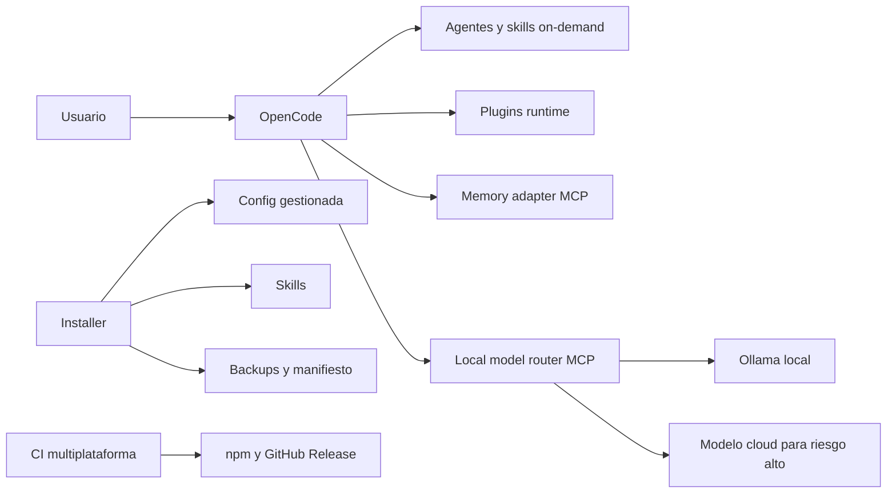

<p align="center">
  
</p>

<p align="center">
  <a href="https://github.com/Rukawua26/opencode-ecosystem/actions/workflows/test.yml"></a>
  <a href="https://www.npmjs.com/package/@rukawua26/opencode-memory-adapter"></a>
  <a href="https://www.npmjs.com/package/@rukawua26/opencode-skills"></a>
  
  
</p>

<p align="center"><b>Un comando. Cualquier agente. Cualquier OS.</b></p>
<p align="center">Configuracion reproducible para OpenCode con memoria local, skills, agentes, routing de modelos y verificacion por riesgo.</p>

## Quick Start

Requiere **Node.js 22+**, npm y Git.

### Linux / macOS

```bash
curl -sSL https://raw.githubusercontent.com/Rukawua26/opencode-ecosystem/main/install.sh | bash
```

### Windows

```powershell
irm -useb https://raw.githubusercontent.com/Rukawua26/opencode-ecosystem/main/install.ps1 | iex
```

Los instaladores descargan `v1.9.0` por defecto. Una reinstalacion normal conserva los archivos existentes. `main` incorpora un modo de sincronizacion que se publicara en la siguiente release; para probarlo sin sustituir `opencode.jsonc` ni archivos custom:

```bash
git clone --depth 1 https://github.com/Rukawua26/opencode-ecosystem.git
cd opencode-ecosystem
bash install.sh --sync
```

```powershell
git clone --depth 1 https://github.com/Rukawua26/opencode-ecosystem.git
Set-Location opencode-ecosystem
.\install.ps1 -Sync
```

`--sync` / `-Sync` respalda antes de reemplazar, conserva rutas no gestionadas y solo retira archivos obsoletos registrados por un manifiesto anterior. Los ultimos 10 backups se guardan en `~/.local/share/opencode/install-backups/`. La primera sincronizacion crea el manifiesto sin podar archivos desconocidos. `--force` / `-Force` reemplaza la distribucion gestionada completa y debe usarse solo cuando se desea ese comportamiento.

Si una sincronizacion falla despues de reemplazar un archivo, cierra OpenCode,
localiza el backup mas reciente y copia su contenido de vuelta conservando la
ruta relativa (`opencode/`, `skills/` o `bin/`). El manifiesto solo se reemplaza
despues de una verificacion completa, por lo que un fallo conserva el ownership
anterior para reintentar.

## Novedades v1.9.0

- Instaladores Bash y PowerShell verificados en Linux, macOS, Alpine y Windows.
- Router MCP reproducible con SDK y lockfile propios.
- Sandbox Docker sin shell del host, sin red, read-only y con limites de CPU/RAM.
- Checkpoints que excluyen `.env`, claves privadas, certificados y credenciales.
- Memory adapter read-only por MCP, SQLite local, busqueda textual y embeddings opcionales.
- Queries vacias no arrancan Ollama; filas sin embedding usan fallback textual.
- Pipeline unico y bloqueante antes del tag, GitHub Release y publicacion npm.

## Componentes

| Componente | Estado actual |
|---|---|
| **16 agentes** | Definiciones especializadas para arquitectura, backend, frontend, seguridad, revision y producto |
| **21 skills** | SDD, prompts, debug, seguridad, TDD y `obsidian-ingest`; cargadas bajo demanda |
| **7 plugins activos por defecto** | guardrails, checkpoints, sandbox, validator, metrics, kanban y personalities |
| **auto-memory** | Plugin disponible pero no activado por defecto; encola candidatos y exige persistencia explicita |
| **2 MCP locales activos** | memory-adapter y local-model-router |
| **2 MCP opt-in** | Context7 y diagram-generator, deshabilitados por defecto |
| **3 perfiles** | work, personal y light |

## Seguridad Y Persistencia

- `sandbox_exec` ejecuta Docker mediante argumentos separados; el shell utilizado vive dentro del contenedor.
- El contenedor usa `--network none`, filesystem read-only, `512m` de memoria y `1` CPU.
- Los checkpoints omiten secretos por ruta y limitan la retencion; sync respalda solo los archivos gestionados que reemplaza o retira.
- El router rechaza credenciales y bloques internos antes de delegar al modelo local.
- El MCP de memoria expone lecturas; las escrituras persistentes requieren CLI local explicita.
- `security-review` es una guia de revision, no una frontera de seguridad runtime.

## Memoria Local

`@rukawua26/opencode-memory-adapter` usa `node:sqlite` y no tiene dependencias runtime. Ofrece:

- busqueda textual determinista con `LIKE`;
- busqueda semantica opcional mediante Ollama;
- fallback textual cuando Ollama o un embedding no estan disponibles;
- eventos JSONL canonicos y verificables;
- aislamiento de lecturas por proyecto;
- escritura solo por CLI explicita.

```bash
npm install -g @rukawua26/opencode-memory-adapter@1.9.0
memory-adapter --help
```

Consulta [`packages/memory-adapter/README.md`](packages/memory-adapter/README.md) para el contrato completo.

## Router Local

| Rol | Modelo fijado |
|---|---|
| Codigo | `qwen2.5-coder:3b` |
| Chat | `llama3.2:latest` |
| Razonamiento | `llama3.2:latest` |

El router valida el digest antes de generar, usa `num_ctx: 4096`, `keep_alive: 1m` y mantiene tareas criticas, amplias o sensibles en el modelo cloud. La respuesta local se marca como asesoramiento no confiable y debe verificarse contra codigo y tests.

## SDD Y Organic RDD

SDD gobierna la construccion de cambios no triviales:

1. Spec: requisitos y escenarios de aceptacion.
2. Plan: enfoque, decisiones, riesgos y archivos.
3. Tasks: implementacion atomica y verificable.
4. Apply: cambio minimo.
5. Verify: pruebas y evidencia.

Organic RDD revisa el candidato ya producido segun impacto:

| Tier | Tipo de cambio | Revision |
|---|---|---|
| 0 | Documentacion | Ligera |
| 1 | Guidance, skills y comandos | Contrato y legibilidad |
| 2 | Configuracion central y gates | Lentes requeridas por receipt |
| 3 | Runtime, permisos, seguridad y persistencia | Revision completa y verificacion obligatoria |

Un receipt congela los hashes del candidato y registra lentes, verificacion y gate. No sustituye los tests ni convierte cambios pequenos en features complejas.

## Verificacion

La release v1.9.0 fue validada con:

- 72 tests Vitest;
- 23 tests del router MCP;
- 43 tests del memory adapter;
- lint, coverage V8, contratos documentales y hooks;
- instaladores reales en Linux, macOS, Alpine y Windows;
- `npm audit` sin vulnerabilidades en la release;
- CodeQL y pipeline de publicacion bloqueante.

Son checks deterministas de software, no Agent Evals. El eval local de estructura JSON es manual y no forma parte del CI:

```bash
npm run eval:local-structure
```

El comando reporta respuestas validas, fallos y tasa por modelo. No compara proveedores comerciales ni afirma calidad cognitiva general.

## Herramientas

```bash
# Salud de la instalacion; Ollama y API keys son opcionales
opencode-doctor

# Metricas de los ultimos siete dias
opencode-metrics 7

# Tests principales del repositorio
npm test
npm run test:router
npm run test:coverage
npm run test:install
```

`opencode-metrics` registra tokens, coste, modelos, herramientas, delegaciones, lecturas amplias, compactaciones, loops y errores. Las cifras de ahorro se consideran hipotesis hasta compararlas con una linea base real; consulta [`docs/token-economy/measurement.md`](docs/token-economy/measurement.md).

## Arquitectura



Detalles adicionales:

- [Arquitectura](docs/architecture/overview.md)
- [Sincronizacion del instalador](docs/architecture/installer-sync.mmd)
- [Medicion de tokens](docs/token-economy/measurement.md)
- [Guia SDD](docs/guides/sdd-step-by-step.md)

## Estructura

```text
opencode-ecosystem/
|-- config/       # configuracion, agentes, plugins, MCP y perfiles
|-- skills/       # 21 skills exportables
|-- packages/     # paquetes npm de memoria y skills
|-- tests/        # tests deterministas e instaladores
|-- tools/        # doctor, metrics, evals y utilidades
|-- docs/         # arquitectura y guias
|-- spec/         # specs, planes, tareas y evidencia
`-- .github/      # CI, CodeQL y automatizacion
```

## API Keys

Las API keys son opcionales y se configuran manualmente cuando se usan proveedores cloud:

```bash
cp .env.example ~/.config/opencode/.env
```

No incluyas `.env`, tokens o credenciales en commits.

## Releases

- GitHub: [`v1.9.0`](https://github.com/Rukawua26/opencode-ecosystem/releases/tag/v1.9.0)
- npm: [`@rukawua26/opencode-memory-adapter`](https://www.npmjs.com/package/@rukawua26/opencode-memory-adapter)
- npm: [`@rukawua26/opencode-skills`](https://www.npmjs.com/package/@rukawua26/opencode-skills)
- Documentacion extendida: [`docs/README.md`](docs/README.md)

## Licencia

[MIT](LICENSE) Copyright 2026 Rukawua26.
