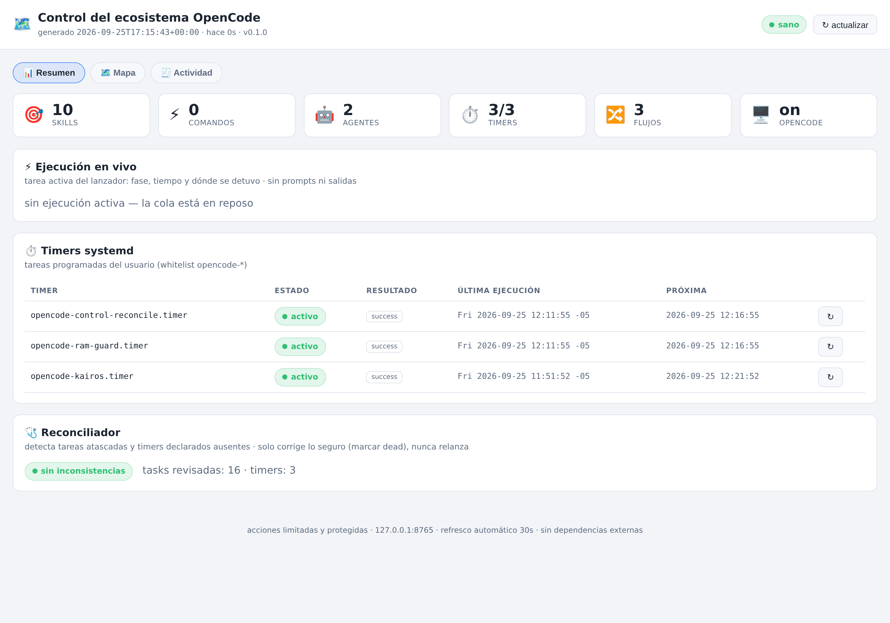
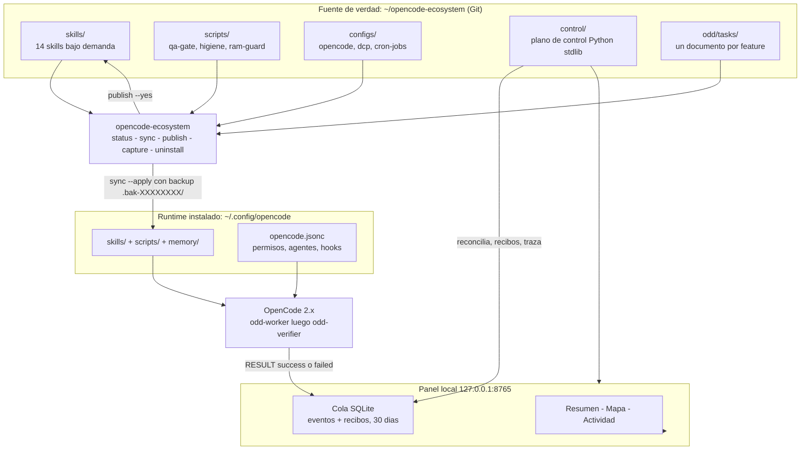
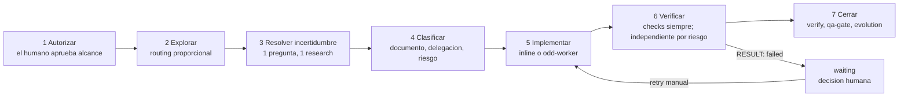
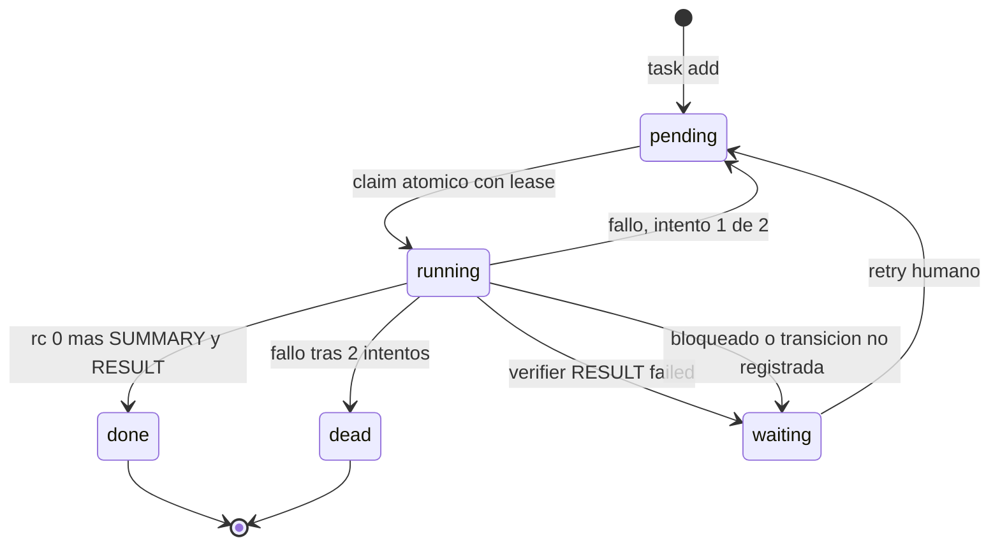
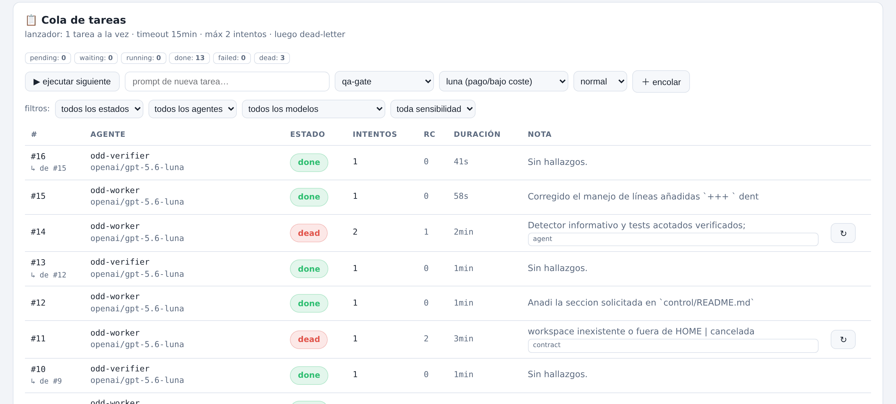

<div align="center">

# opencode-ecosystem

**Fuente de verdad del ecosistema OpenCode.** Skills, memoria, scripts, plano de control
y flujo de trabajo ODD, en Python stdlib, para una máquina de 8 GB.



</div>

---

## Qué es

### Abrir con aviso de version (opcional)

Ejecuta `~/opencode-ecosystem/opencode-checked` en lugar de `opencode`.
Compara con `~/.config/opencode/.opencode-version.pin` mediante una consulta
local `--version` (timeout de 3 segundos). Con el mismo pin no imprime nada.
Si difiere, muestra ambas versiones y pregunta **solo sin argumentos y con
stdin/stderr en TTY**. Con argumentos (incluidos rutas, `run`, `--help` y
`--version`) o sin TTY, informa sin preguntar. Conserva argumentos y exit code.

Aceptar autoriza solamente una revision: **no comunica consentimiento al agente**.
Pide la revision en el chat; no se inyecta ningun prompt, no se cambia el pin,
no se adapta ni actualiza nada. Rechazo/EOF abre normalmente sin adaptar.
Pin ausente/invalido o probe fallido avisan y dejan abrir sin inferir permiso.
`OPENCODE_BIN` permite seleccionar el binario; apuntar al lanzador se rechaza.

No instala alias, perfiles ni plugins: el binario directo `opencode` sigue
disponible sin este aviso. No cubre web/API ni sesiones nuevas dentro de una
TUI ya abierta. No se requiere sync para este ejecutable del repositorio.

Repo local (y privado) que contiene **todo** lo que OpenCode necesita para trabajar
con disciplina: reglas del agente, skills curadas, plantillas de memoria, scripts de
higiene y calidad, y un plano de control que observa el runtime real y lanza
subagentes con verificación independiente.

Derivado de `noffolo/opencode-ecosystem`, adaptado a **i5-1235U / 8 GB RAM** con
filosofía de **ahorro de tokens, YAGNI y stdlib solamente**.

| | |
|---|---|
| Lenguaje | Python 3, **solo stdlib**: 0 dependencias de runtime |
| Tests | Suite con `unittest` (skip opt-in; Playwright solo si existe) |
| Skills | 14 bajo demanda (incluidas 5 lentes 4R) |
| Panel | `http://127.0.0.1:8765` (HTTP en loopback, no expuesto a la LAN) |
| Persistencia | SQLite local, retención 30 días / 20 000 filas |

## Arquitectura



> Fuentes editables en [`docs/architecture/`](docs/architecture/).

## Arranque rápido

```bash
cd ~/opencode-ecosystem

./opencode-ecosystem status          # diff ECO vs ~/.config/opencode
./opencode-ecosystem sync --apply    # instalar la fuente de verdad en el runtime
./verify.sh                          # cierre único: tests + validadores + QA strict

python3 -m control --serve           # panel local -> http://127.0.0.1:8765
```

### Regla anti-wipe

`sync` va **ECO → CFG** y pisa los cambios hechos en caliente.

| Acción | Dirección | Cuándo |
|---|---|---|
| `status` | — | siempre, antes de dudar |
| `sync --apply` | ECO → CFG | editaste este repo |
| `publish --yes` | CFG → ECO | editaste `~/.config/opencode` a mano |
| `capture --apply` | — | recuperación manual controlada |
| `uninstall [--apply]` | — | inverso selectivo por manifiesto (preview por defecto) |

Nunca se sincronizan `.env`, `observations.log`, `topics/`, logs, backups ni plugins
personales. `uninstall` los **retiene** por diseño. Reinicia OpenCode si cambian
plugins, config de arranque o skills.

`MEMORY.md` solo se siembra si falta y nunca se elimina por uninstall, incluso
con manifiestos antiguos. Copias/backup fallidos devuelven error; sync/publish
no son transacciones globales y pueden haber aplicado copias anteriores al fallo.
Publish prepara y valida skills antes de sustituirlas; su rollback es acotado a
esa sustitución. El ejecutable raíz y `control/` no se instalan mediante sync.

## Flujo de trabajo ODD

Un solo documento por feature en `odd/tasks/<feature>.md`: objetivo, alcance, no
romper, TDD, tareas, criterios de aceptación, reutilización investigada, evidencia
y progreso.



- Trabajo pequeño entendido: **inline**, sin artefactos.
- Trabajo sustancial con decisiones, dependencias o progreso recuperable: documento
  ODD y alcance aprobado; puede implementarse **inline** con checks funcionales.
- Documento, delegacion y revision independiente son decisiones separadas. Delegar
  requiere contexto limpio, paralelismo realmente independiente o aislamiento
  justificado; contar archivos, writes, lecturas o capas no obliga (profundidad 1).
- Riesgo en datos persistentes, seguridad, contratos, concurrencia, entrega/entorno
  o falta de prueba eficaz exige verificador independiente, incluso inline.
  La incertidumbre peligrosa se aclara; no se presume bajo riesgo. Se conservan
  aprobaciones y guardas especializadas de seguridad/arquitectura de alto riesgo.
- Al entrar al control-plane, `odd-worker` exitoso encadena siempre `odd-verifier`
  y `assess`; no se saltan gates ni se reclasifican tareas previas automaticamente.
  El verifier read-only tambien puede revisar inline fuera de esa cadena, sin
  autorizar mutaciones ni emitir continuaciones. Checks y qa-gate siempre.
- Un `RESULT: failed` del verificador deja la tarea en `waiting`: la decisión es
  humana, no un reintento ciego.

### Estados de una tarea



El texto del modelo **nunca llega al shell**: solo el control-plane registrado puede
publicar una transición ejecutable.

## Plano de control

Panel local que contrasta lo **observado** (fs, systemd, `opencode service status`)
con lo **declarado** (flujos ODD), y guarda eventos y recibos en SQLite local.



```bash
python3 -m control --once --pretty              # snapshot una vez
python3 -m control --serve                     # panel en 127.0.0.1:8765
python3 -m control.cli status                  # CLI rápido
python3 -m control.cli doctor --json           # diagnóstico sanitizado
python3 -m control.cli task list               # cola
python3 -m control.cli task assess <worker_id> # revisión sin ejecutarla
python3 -m control.cli task run                # 1 tarea a la vez
```

El servidor permite acciones POST cerradas (encolar, ejecutar, reintentar/cancelar
tareas y reiniciar timers), con controles CSRF/Origin; no es solo lectura.
Qué **no** hace: no acepta comandos arbitrarios desde el navegador, no abre la API
interna de OpenCode, no muestra prompts ni secretos, no relanza trabajo solo y no
guarda la salida completa de los modelos. Detalle en [`control/README.md`](control/README.md).

## Skills

Se cargan **bajo demanda**: OpenCode lee nombre y descripción; el cuerpo solo entra
en contexto al invocar la skill.

| Skill | Para qué |
|---|---|
| `organic-workflow-lite` | Flujo ODD y documento único de feature |
| `ultraplan-lite` | 2-3 enfoques y elegir el mínimo antes de implementar |
| `code-forge-fix-lite` | Reproducir un fallo, causa raíz y fix mínimo verificable |
| `context-compressor` | Contexto grande, `CONTEXT_MAP.md`, presión de tokens o RAM |
| `qa-gate` | Staged diff: anti-slop, secretos y señales de riesgo en líneas añadidas |
| `git-atomic-committer` | Commits atómicos, staged diff y estilo del repo |
| `risk-lens` | 4R: errores no verificados, fallos silenciosos, edge cases |
| `resilience-lens` | 4R: red, timeouts, fallbacks y degradación elegible |
| `reliability-lens` | 4R: flakiness, mocks frágiles, aserciones no deterministas |
| `readability-lens` | 4R: sugiere revisión humana de legibilidad, nunca bloquea |
| `security-lens` | 4R: inyección, control de acceso y fuga de credenciales en el diff; complementa a `qa-gate`, nunca bloquea |
| `supabase-apply-lite` | Migración, despliegue de Edge Function y verificación en el remoto |
| `ui-ux-master` | Diseño y revisión visual de interfaces web, tokens y accesibilidad |
| `web-quality-lite` | Estandar web de 20 puntos (legal, SEO, accesibilidad, rendimiento) |

Las cinco lentes informan; ninguna bloquea. Edita siempre la fuente en
`skills/<name>/SKILL.md` y después:

```bash
python3 ./validate-skills.py ./skills
./opencode-ecosystem sync --apply
./opencode-ecosystem status          # debe terminar en [ok] sin drift
opencode debug config                # la config resuelta debe listar las fuentes
```

Reinicia OpenCode para cargar la skill actualizada y documenta el cambio en
`docs/evolution/` (patrón `_TEMPLATE.md`).

## Scripts

| Script | Uso |
|---|---|
| `scripts/qa-gate.sh` | Índice canónico + rutas rastreadas raíz; warn=0 por hallazgos, strict=1 por bloqueantes, error/incompleto=2 |
| `scripts/hygiene.sh` | `triggers`, `prune`, `reset` — manual y **preview por defecto** |
| `scripts/ram-guard-lite.sh` | Si RAM disponible <15%, intenta terminar procesos que coincidan con `ollama run` y escribe su log |
| `scripts/co-change-analyzer.sh` | Sugiere qué revisar junto tras un cambio |

QA analiza texto añadido: secretos y `catch` vacío bloquean en strict; logs,
TODO/FIXME y riesgos avisan. Solo los riesgos excluyen tests/comentarios, no los
secretos. Ignora `GIT_*` heredado; sin staged declara **no aplicable**, pero aún
comprueba rutas sensibles rastreadas. No certifica unstaged ni es SAST/SCA.
No imprime fragmentos fuente: solo ubicación saneada y etiquetas fijas. Git tiene
15 s por consulta y 16 MiB de **lectura** por salida (no hard cap de disco/RAM);
presenta hasta 50 hallazgos, evaluando todos. Binarios, formatos no soportados o
diffs incompletos devuelven 2 incluso en warn; acepta vacíos válidos SHA-1/SHA-256.

RAM guard no compacta contexto ni comprueba que los procesos sean huérfanos:
usa `pkill -f "ollama run"`, por lo que puede alcanzar sesiones activas. El log
no demuestra que haya terminado un proceso (el fallo de pkill se ignora).
Se documenta la política existente; no se cambia el umbral ni el script.

### DCP: configuración conservada, consumidor no acreditado

`configs/dcp.jsonc` se copia y compara, pero eso no prueba que se ejecute DCP.
En esta fuente solo se encontraron consumidores de gestión/inventario (CLI y
`control/collect.py`), no un motor de poda. La consulta efectiva `/api/config`
del 2026-10-14 no mostró referencia a un plugin DCP ni clave DCP efectiva.
Estado operativo: **inactivo/no acreditado**, aunque el archivo diga
`enabled: true`; no se activa ni se atribuyen ahorros o umbrales efectivos
32–40k. La compactación nativa observada es `auto=true, buffer=8000`, distinta
de ese archivo. No se descarta un consumidor externo no observado.

### Higiene

```bash
./scripts/hygiene.sh triggers      # estado y si dispara
./scripts/hygiene.sh prune          # preview de backups podables
./scripts/hygiene.sh prune --apply  # conserva 5 por basename
./scripts/hygiene.sh reset          # preview (logs y topics)
./scripts/hygiene.sh reset --confirm
```

`reset` conserva `MEMORY.md` y los `.sh`; solo trunca `observations.log` a 50
líneas. Pin de backups: renombra a `.bak-pinned` y `prune` lo ignorará.

## Contenido

| Ruta | Qué hay |
|---|---|
| `AGENTS.md` | Reglas del agente: autorización, ODD, routing, autopistas de contexto |
| `skills/` | 14 skills bajo demanda (incluidas 5 lentes 4R) |
| `scripts/` | `qa-gate.sh`, `hygiene.sh`, `ram-guard-lite.sh`, `co-change-analyzer.sh` |
| `configs/` | `opencode.jsonc`, `dcp.jsonc`, `cron-jobs.json` |
| `control/` | Plano de control: panel, lanzador, SQLite, CLI y tests |
| `odd/tasks/` | Un documento ODD por feature activa o cerrada |
| `memory/` | Plantillas: `kairos.sh`, `autodream.sh`, `MEMORY.md` (lo vivo queda en `~/.config`) |
| `docs/architecture/` | Diagramas `.mmd` editables |
| `docs/evolution/` | Historial de cambios al ecosistema |
| `opencode-ecosystem` | CLI de gestión ECO ↔ CFG |

`commands/` está reservado para comandos personalizados; hoy no hay ninguno.

## Timers

`configs/cron-jobs.json` es **declarativo**. El ejecutor real son los timers
`systemd --user`:

| Timer | Cada | Qué hace |
|---|---|---|
| `opencode-ram-guard.timer` | 5 min | RAM disponible <15%: intenta terminar `ollama run` |
| `opencode-control-reconcile.timer` | 5 min | Marca `dead` lo atascado, nunca relanza |
| `opencode-kairos.timer` | 30 min | Consolida memoria |

Son frecuencias nominales: las unidades observadas usan intervalos monotónicos
desde activación/arranque; `*/5` o `*/30` del JSON son calendarios cron y no
prueban horarios equivalentes. Editar el JSON no modifica unidades ni instala
un ejecutor. Cualquier cambio de timers requiere autorización aparte.

`./opencode-ecosystem status` compara bytes de `opencode.jsonc`, `dcp.jsonc` y
`cron-jobs.json`, árboles `skills/` y `scripts/`, `commands/` si existe en fuente
(excluye `*.bak-*`), y solo `memory/kairos.sh` y `memory/autodream.sh`.
No valida semántica JSON, permisos, consumidores DCP, memoria viva, instalación
de timers ni sus horarios/comandos/resultados. Un error de comparación también
es drift (exit 1), nunca `[ok]`.

El panel contrasta nombres/presencia/actividad de timers, no equivalencia de
schedule/command. Fallos de detalle systemd quedan `unknown` y degradan salud;
lista ausente/fallida se representa vacía, sin distinguir indisponibilidad de
ausencia. Las advertencias de divergencia no hacen por sí solas `health.ok=false`.

## Verificación

```bash
./verify.sh                                     # cierre local único, sin argumentos
```

Ejecuta secuencialmente hygiene triggers, validadores de skills fuente/runtime,
config resuelta, drift, doctores de plugins/contexto, discovery no vacío,
`python3 -m unittest discover -s control/tests`, consulta staged y QA strict.
QA siempre se ejecuta, incluso sin staged. Cada control muestra etiqueta,
estado y alcance (`ok`, `warn`, `fail`, `unavailable`, `incomplete`); descarta
stdout/stderr de los hijos, sin persistir sus detalles. Hygiene rc=1 es aviso.
Exit 0 exige todos los obligatorios completos; 1 significa cierre rojo;
2, argumentos inválidos o entorno inicial no disponible.

Tests leen el **working tree**; QA usa el **índice canónico y rutas rastreadas raíz**
de `~/opencode-ecosystem`, ignorando `GIT_*` heredado. No congela un candidato ni
certifica código unstaged. Los comandos individuales siguen disponibles para
diagnóstico (`validate-skills.py`, `status`, unittest y `qa-gate.sh --strict`).
Timeout GNU aplica KILL al grupo normal al deadline (15/30/60/180 s según control),
no a procesos deliberadamente detached fuera de él. Desactiva trace/verbose/errexit
heredados; `BASH_ENV` previo al arranque queda fuera de esa garantía: no es sandbox.
Límites, rollback y evidencia pendiente: [cierre fiable](docs/evolution/2026-10-03-cierre-fiable.md).

## Ámbito: global vs proyecto

- **Global** (`~/.config/opencode`, este repo): todo lo anterior. Es el default.
- **Proyecto** (`opencode.json` en la raíz del repo): solo overrides puntuales
  (modelo, 1-2 permisos). Nunca dupliques lo global; el merge de OpenCode ya lo
  combina con precedencia **proyecto > global**.

## Paridad con gentle-ai

Repo privado, patrón **tomado como fuente de ideas, no replicado**:

| TOMAMOS | DEJAMOS (y por qué) |
|---|---|
| ODD como flujo por defecto | SDD/OpenSpec (retirado upstream y aquí) |
| Fail-closed y transiciones registradas | RDD completo, lineage y replay de autoridad |
| TDD y revisión de riesgo por líneas añadidas | TDD obligatorio en docs/config (gasta tokens) |
| Routing proporcional y `assess` | TUI, binario Go, Gentle Shell, multi-runtime |
| SQLite local con retención acotada | Engram, telemetría VictoriaMetrics, updater de repos |

Baseline y análisis permanente: `~/docs/sources/gentle-ai-analysis.md`.

## Licencia

Privado. Sin licencia pública.
