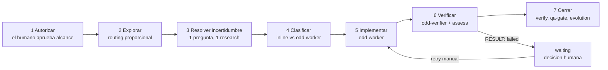
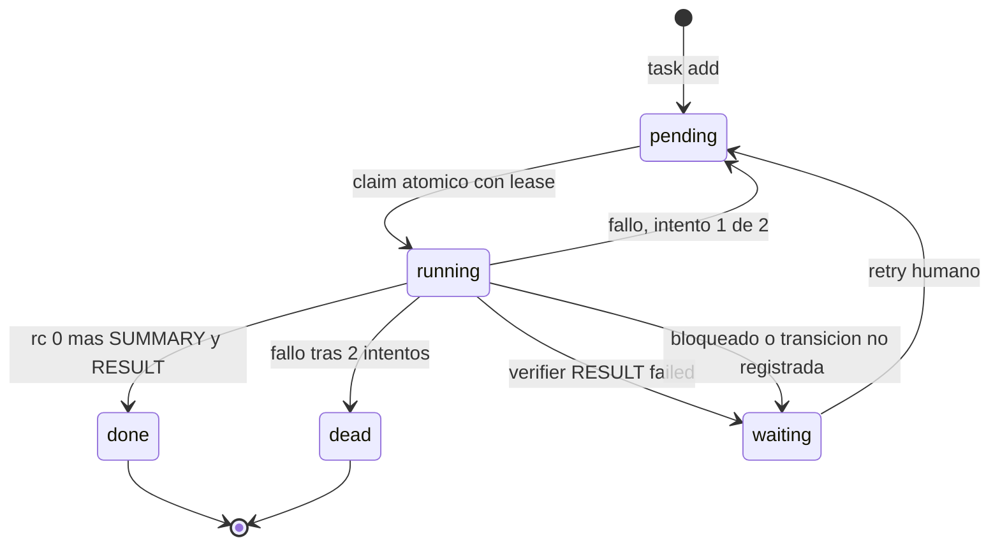

<div align="center">

# opencode-ecosystem

**Fuente de verdad del ecosistema OpenCode.** Skills, memoria, scripts, plano de control
y flujo de trabajo ODD, en Python stdlib, para una máquina de 8 GB.


</div>

---

## Qué es

Repo local (y privado) que contiene **todo** lo que OpenCode necesita para trabajar
con disciplina: reglas del agente, skills curadas, plantillas de memoria, scripts de
higiene y calidad, y un plano de control que observa el runtime real y lanza
subagentes con verificación independiente.

Derivado de `noffolo/opencode-ecosystem`, adaptado a **i5-1235U / 8 GB RAM** con
filosofía de **ahorro de tokens, YAGNI y stdlib solamente**.

| | |
|---|---|
| Lenguaje | Python 3, **solo stdlib**: 0 dependencias de runtime |
| Tests | 159 con `unittest` (1 skip opt-in; Playwright solo si existe) |
| Skills | 10 (6 núcleo + 4 lentes 4R) |
| Panel | `http://127.0.0.1:8765` (local, sin red) |
| Persistencia | SQLite local, retención 30 días / 20 000 filas |

## Arquitectura


> Fuentes editables en [`docs/architecture/`](docs/architecture/).

## Arranque rápido

```bash
cd ~/opencode-ecosystem

./opencode-ecosystem status          # diff ECO vs ~/.config/opencode
./opencode-ecosystem sync --apply    # instalar la fuente de verdad en el runtime
./verify.sh                          # triggers + config + status + doctores

python3 -m control --serve           # panel local -> http://127.0.0.1:8765
```

### Regla anti-wipe

`sync` va **ECO → CFG** y pisa los cambios hechos en caliente.

| Acción | Dirección | Cuándo |
|---|---|---|
| `status` | — | siempre, antes de dudar |
| `sync --apply` | ECO → CFG | editaste este repo |
| `publish --yes` | CFG → ECO | editaste `~/.config/opencode` a mano |
| `capture --apply` | — | recuperación manual controlada |
| `uninstall [--apply]` | — | inverso selectivo por manifiesto (preview por defecto) |

Nunca se sincronizan `.env`, `observations.log`, `topics/`, logs, backups ni plugins
personales. `uninstall` los **retiene** por diseño. Reinicia OpenCode si cambian
plugins, config de arranque o skills.

## Flujo de trabajo ODD

Un solo documento por feature en `odd/tasks/<feature>.md`: objetivo, alcance, no
romper, TDD, tareas, criterios de aceptación, reutilización investigada, evidencia
y progreso.



- Trabajo pequeño entendido: **inline**, sin artefactos.
- Trabajo sustancial (2+ pasos o progreso recuperable): **delegado** a
  `odd-worker` y contrastado por `odd-verifier` en contexto fresco (profundidad 1).
- Un `RESULT: failed` del verificador deja la tarea en `waiting`: la decisión es
  humana, no un reintento ciego.

### Estados de una tarea



El texto del modelo **nunca llega al shell**: solo el control-plane registrado puede
publicar una transición ejecutable.

## Plano de control

Panel local que contrasta lo **observado** (fs, systemd, `opencode service status`)
con lo **declarado** (flujos ODD), y guarda eventos y recibos en SQLite local.


```bash
python3 -m control --once --pretty              # snapshot una vez
python3 -m control --serve                     # panel en 127.0.0.1:8765
python3 -m control.cli status                  # CLI rápido
python3 -m control.cli doctor --json           # diagnóstico sanitizado
python3 -m control.cli task list               # cola
python3 -m control.cli task assess <worker_id> # revisión sin ejecutarla
python3 -m control.cli task run                # 1 tarea a la vez
```

Qué **no** hace: no acepta comandos arbitrarios desde el navegador, no abre la API
interna de OpenCode, no muestra prompts ni secretos, no relanza trabajo solo y no
guarda la salida completa de los modelos. Detalle en [`control/README.md`](control/README.md).

## Skills

Se cargan **bajo demanda**: OpenCode lee nombre y descripción; el cuerpo solo entra
en contexto al invocar la skill.

| Skill | Para qué |
|---|---|
| `organic-workflow-lite` | Flujo ODD y documento único de feature |
| `ultraplan-lite` | 2-3 enfoques y elegir el mínimo antes de implementar |
| `code-forge-fix-lite` | Reproducir un fallo, causa raíz y fix mínimo verificable |
| `context-compressor` | Contexto grande, `CONTEXT_MAP.md`, presión de tokens o RAM |
| `qa-gate` | Staged diff: anti-slop, secretos y señales de riesgo en líneas añadidas |
| `git-atomic-committer` | Commits atómicos, staged diff y estilo del repo |
| `risk-lens` | 4R: errores no verificados, fallos silenciosos, edge cases |
| `resilience-lens` | 4R: red, timeouts, fallbacks y degradación elegible |
| `reliability-lens` | 4R: flakiness, mocks frágiles, aserciones no deterministas |
| `readability-lens` | 4R: sugiere revisión humana de legibilidad, nunca bloquea |

Las cuatro lentes informan; ninguna bloquea. Edita siempre la fuente en
`skills/<name>/SKILL.md` y después:

```bash
python3 ./validate-skills.py ./skills
./opencode-ecosystem sync --apply
opencode debug skill
```

Reinicia OpenCode para cargar la skill actualizada y documenta el cambio en
`docs/evolution/` (patrón `_TEMPLATE.md`).

## Scripts

| Script | Uso |
|---|---|
| `scripts/qa-gate.sh` | Staged diff: `catch` vacío, secretos, logs, TODO/FIXME y riesgos en líneas añadidas. `--strict` bloquea lo crítico |
| `scripts/hygiene.sh` | `triggers`, `prune`, `reset` — manual y **preview por defecto** |
| `scripts/ram-guard-lite.sh` | Presión de RAM: avisa y recorta contexto si toca el techo |
| `scripts/co-change-analyzer.sh` | Sugiere qué revisar junto tras un cambio |

### Higiene

```bash
./scripts/hygiene.sh triggers      # estado y si dispara
./scripts/hygiene.sh prune          # preview de backups podables
./scripts/hygiene.sh prune --apply  # conserva 5 por basename
./scripts/hygiene.sh reset          # preview (logs y topics)
./scripts/hygiene.sh reset --confirm
```

`reset` conserva `MEMORY.md` y los `.sh`; solo trunca `observations.log` a 50
líneas. Pin de backups: renombra a `.bak-pinned` y `prune` lo ignorará.

## Contenido

| Ruta | Qué hay |
|---|---|
| `AGENTS.md` | Reglas del agente: autorización, ODD, routing, autopistas de contexto |
| `skills/` | 10 skills (6 núcleo + 4 lentes 4R) |
| `scripts/` | `qa-gate.sh`, `hygiene.sh`, `ram-guard-lite.sh`, `co-change-analyzer.sh` |
| `configs/` | `opencode.jsonc`, `dcp.jsonc`, `cron-jobs.json` |
| `control/` | Plano de control: panel, lanzador, SQLite, CLI y tests |
| `odd/tasks/` | Un documento ODD por feature activa o cerrada |
| `memory/` | Plantillas: `kairos.sh`, `autodream.sh`, `MEMORY.md` (lo vivo queda en `~/.config`) |
| `docs/architecture/` | Diagramas `.mmd` editables |
| `docs/evolution/` | Historial de cambios al ecosistema |
| `opencode-ecosystem` | CLI de gestión ECO ↔ CFG |

`commands/` está reservado para comandos personalizados; hoy no hay ninguno.

## Timers

`configs/cron-jobs.json` es **declarativo**. El ejecutor real son los timers
`systemd --user`:

| Timer | Cada | Qué hace |
|---|---|---|
| `opencode-ram-guard.timer` | 5 min | Vigila RAM y recorta contexto |
| `opencode-control-reconcile.timer` | 5 min | Marca `dead` lo atascado, nunca relanza |
| `opencode-kairos.timer` | 30 min | Consolida memoria |

Si editas el JSON, replica el cambio en `~/.config/systemd/user/` y haz
`daemon-reload`. Alternativa sin systemd: cron clásico con las mismas líneas.

## Verificación

```bash
python3 -m unittest discover -s control/tests   # 159 tests
./verify.sh                                     # vista única de cierre
./scripts/qa-gate.sh --strict                   # staged diff
python3 validate-skills.py skills               # 10 skills válidas
./opencode-ecosystem status                     # [ok] sin drift
```

## Ámbito: global vs proyecto

- **Global** (`~/.config/opencode`, este repo): todo lo anterior. Es el default.
- **Proyecto** (`opencode.json` en la raíz del repo): solo overrides puntuales
  (modelo, 1-2 permisos). Nunca dupliques lo global; el merge de OpenCode ya lo
  combina con precedencia **proyecto > global**.

## Paridad con gentle-ai

Repo privado, patrón **tomado como fuente de ideas, no replicado**:

| TOMAMOS | DEJAMOS (y por qué) |
|---|---|
| ODD como flujo por defecto | SDD/OpenSpec (retirado upstream y aquí) |
| Fail-closed y transiciones registradas | RDD completo, lineage y replay de autoridad |
| TDD y revisión de riesgo por líneas añadidas | TDD obligatorio en docs/config (gasta tokens) |
| Routing proporcional y `assess` | TUI, binario Go, Gentle Shell, multi-runtime |
| SQLite local con retención acotada | Engram, telemetría VictoriaMetrics, updater de repos |

Baseline y análisis permanente: `~/docs/sources/gentle-ai-analysis.md`.

## Licencia

Privado. Sin licencia pública.
