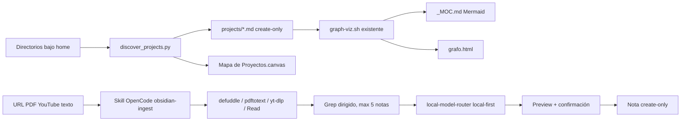

# Plan: Obsidian Project Knowledge

## Decisión

Implementar dos componentes pequeños y separados:

1. Un descubridor Python stdlib, ligado al vault, para datos mecánicos y grafo.
2. Un skill OpenCode declarativo para ingestión semántica bajo demanda.

No se crea un proyecto independiente ni se instala `claude-obsidian`. Esta división evita usar LLM para operaciones determinísticas y mantiene la síntesis como una acción explícita.

## Diseño

## Archivos

| Archivo | Cambio |
|---|---|
| `~/docs/scripts/discover_projects.py` | Descubrimiento, notas y Canvas |
| `~/docs/scripts/test_discover_projects.py` | Tests stdlib |
| `~/docs/canvases/Mapa de Proyectos.canvas` | Salida generada |
| `~/docs/projects/*.md` | Solo notas faltantes |
| `~/docs/templates/ingest-rules.md` | Reglas personales en español |
| `skills/obsidian-ingest/SKILL.md` | Skill fuente del ecosistema |
| `packages/skills/skills/obsidian-ingest/SKILL.md` | Skill empaquetado npm |
| `packages/skills/tests/skills.test.js` | Cobertura de registro/contenido si aplica |
| `docs/architecture/obsidian-project-knowledge.mmd` | Diagrama mantenible |
| `spec/features/003-obsidian-project-knowledge/*` | Spec, plan, tareas y verificación |

## Descubrimiento

- Enumerar `home.iterdir()`; no recursivo.
- Rechazar ocultos, symlinks y nombres del ignore set.
- Leer archivos de metadatos con un helper limitado a 128 KiB.
- Detectar tecnologías con una tabla pequeña de tokens conocidos.
- Obtener resumen del primer párrafo útil de README o AGENTS, limitado a 280 caracteres.
- Asignar área por señales determinísticas: trading, ai-agents, web-app, security-blockchain, infrastructure o general.

## Relaciones

- Referencia explícita: el nombre normalizado completo de otro proyecto aparece como secuencia de tokens en README/AGENTS; la arista sale del proyecto que lo menciona.
- Stack compartido: intersección de al menos dos tecnologías.
- Una pareja produce una sola arista; referencia explícita tiene precedencia.
- Las notas nuevas enlazan al stem real de la nota relacionada y usan el nombre del proyecto como alias; notas existentes no se editan.

## Escritura

- Sin `--apply`, imprimir un resumen JSON y salir sin escribir.
- Con `--apply`, crear notas nuevas mediante `open(..., "x")` y Canvas mediante temp + `os.replace` solo si cambia.
- Prevalidar el marcador del MOC y ejecutar `_graph_gen.py --vault VAULT` desde la misma instalación confiable únicamente después de completar las escrituras.
- `_graph_gen.py` escribe MOC/HTML mediante temp + fsync + replace y escapa el contenido Mermaid antes de incrustarlo en HTML.

## Skill OpenCode

- El skill es guidance, no runtime nuevo.
- Usa tools disponibles en OpenCode; no llama a Claude ni contiene API keys.
- Usa el MCP `local-model-router` para síntesis y respeta `route: cloud`.
- Por defecto solo preview; la aplicación requiere aprobación humana.

## Verificación

- `python3 -m unittest ~/docs/scripts/test_discover_projects.py`
- Dry-run sobre un home temporal y sobre `/home/miguel`.
- Apply sobre fixture temporal; repetir y comparar hashes.
- Validar JSON Canvas e integridad de endpoints.
- Tests/lint del monorepo OpenCode.
- Organic RDD Tier 1 para skill/guidance y revisión adicional del script por su escritura local.
